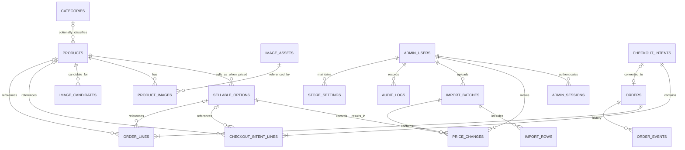

# TOKO TIMBANG SEPAKAT — ERD & DATABASE SPECIFICATION
**Versi 1.0 | 12 Oktober 2026**

**Implementation target:** Cloudflare D1 (SQLite), SQL migration di `TTS_Database_Schema_v1.0.sql`. Skema telah lolos **uji sintaks SQLite lokal**, tetapi tetap wajib diuji di Cloudflare D1 lokal dan deployment preview; bukan klaim sudah berjalan di production. Adapter/repository layer harus memungkinkan migrasi ke Postgres nanti.

## 1. Entity relationship diagram

Catatan: `products` default `draft`; saat seed review complete, publish produk yang minimal punya nama dan opsi harga valid, tanpa menunggu semua foto. `PRODUCT_IMAGES` boleh kosong. Mermaid memakai notasi o| pada beberapa hubungan opsional yang perlu disesuaikan ke foreign key actual; SQL menjadi sumber authoritative untuk cardinality dan uniqueness. Produk berstatus draft bisa mempunyai 0 opsi harga sampai siap terbit; relasi kategori nullable. Kewajiban minimal satu opsi aktif per produk `published` ditegakkan pada service layer.

## 2. Entitas kunci dan alasan desain

| Tabel | Fungsi / invariant utama |
|---|---|
| `categories` | Navigasi kategori edit-able (hierarki opsional) |
| `products` | Satu item dari 94 row sumber; `id` immutable; `source_name`, `source_key`, `source_data_json` tidak dibuang; `sku` user-editable opsional |
| `sellable_options` | Pilihan harga per pcs/karton pack; harga integer IDR, `source_price_column`, `unit_label`, `pack_quantity` nullable |
| `admin_users`, `admin_sessions` | Akses admin. Hash token session; jangan simpan token plaintext dalam DB |
| `import_batches`, `import_rows` | Preview, mapping, validation, diff, hasil batch; tidak boleh silent overwrite |
| `price_changes` | Audit harga lama-baru per sellable option |
| `image_candidates` | Hasil discover crawler, status hak pakai dan kecocokan; belum berarti published |
| `image_assets`, `product_images` | Media yang hak pakainya jelas dan sudah cocok; bisa satu produk multi foto, hanya satu utama |
| `checkout_intents`, `checkout_intent_lines` | Pre-filled WhatsApp draft snapshot, belum pesanan resmi |
| `orders`, `order_lines` | Order admin-konfirmasi; snapshots independen dari harga katalog |
| `order_events` | Perubahan status/angka order tercatat actor, previous/next |
| `audit_logs` | Mutasi sensitif lain: produk, stok label, logo config, setting WA |
| `store_settings` | Informasi toko dan nomor WhatsApp yang dapat diganti tanpa coding |

## 3. Identitas dan referential integrity

- `products.id` UUID/ULID opaque, tidak pernah berubah; `source_key=RENJANA-001..094` untuk trace, bukan SKU; `slug` bisa berubah dengan redirect strategy.
- Satu row source dapat mempunyai **dua** opsi berharga. **94 produk, 106 opsi harga** pada initial seed (35 karton/pack + 71 pcs). Tidak ada opsi buat sel kosong.
- `sellable_options.sku` tidak wajib. Jika admin mengisi, harus unik. Produk punya `sku` opsional untuk skenario item-level, tetapi storefront memilih `option.id` untuk harga.
- `source_price_column` fixed `karton_pack/pcs` untuk import source. SKU dan `unit_label` bisa diedit tanpa merusak hubungan ke source.
- `product_images` valid hanya jika mengacu ke `image_assets` dengan usage_rights `owned/permitted/licensed`; perubahan foto tidak merubah snapshot harga order.
- `checkout_intents.idempotency_key` unik; upsert/retry sama request harus return referensi sama tanpa menggandakan intent.
- Satu intent boleh menjadi satu order maksimal (`orders.checkout_intent_id UNIQUE`), tetapi admin juga bisa membuat order manual tanpa intent.
- `order_lines`/`checkout_intent_lines` menyimpan nama, satuan, harga saat itu; relasi ke opsi optional agar histori tidak hilang ketika item di-archive.

## 4. Numerical rules dan transaction boundary

- `price_idr`, `line_total_idr`, `subtotal_idr`, `shipping_fee_idr`, `total_idr` disimpan integer rupiah (no floating point); validasi qty positive, bounded.
- Aritmetika di server; checkout atomic transaction: validate option states + read prices → create intent + lines + message_snapshot, idempotent. Bila D1 limitations menghalangi database transaction semantics yang diasumsikan, gunakan D1 batch/transaction pattern yang benar dan uji race/conflict. Jangan klaim atomic tanpa test.
- Ketika `price` diedit: lock/version control optimistic update → insert price_changes + audit in same transaction. Klien lama wajib reprice.
- Admin order: `order_lines` original from intent, lalu perubahan karena WA dicatat pada event & snapshots; recompute server; `total= subtotal + shipping_fee` bila shipping_fee diketahui, kalau belum `total=NULL` dan UI `Total akhir dikonfirmasi admin`.
- Ketika qty/order disepakati ulang, perubahan tidak berlaku tanpa event record; cancel tidak menghapus history.
- Semua waktu simpan UTC (format ISO 8601) dan tampil locale `id-ID`, Asia/Jakarta untuk UI.

## 5. State machine

**Product**: `draft` → `published` → `archived`; archived tidak tampil di katalog, riwayat tetap ada. **Availability** terpisah dari product state: `ask_admin` / `available` / `unavailable`.

**Checkout Intent**: `created` → `converted` (admin), atau `abandoned` (manual/kebijakan retensi). **Jangan** menambahkan status `sent` atau `received` tanpa API WhatsApp yang benar-benar memverifikasi.

**Order**: `confirmed` → `awaiting_payment` → `paid` → `preparing` → `completed`, atau `cancelled` dari state yang diperbolehkan. Karena operasional manual, admin boleh melompati state dengan alasan yang tercatat bila diperlukan; enforcement ada di service layer, bukan percayakan UI.

**Image Candidate**: `pending` → `approved/rejected`. `approved` hanya jika `rights_status` allowed dan kecocokan meyakinkan. `unknown` tetap pending.

**Import Batch**: `preview` → `committed/rejected/failed`. Preview belum mengubah harga katalog.

## 6. Invariants audit & privacy

- Gunakan session cookie `HttpOnly Secure SameSite` dan hash password kuat; jangan pernah menyimpan password mentah, token session plaintext, atau WA nomor pelanggan yang tidak disediakan.
- `buyer_name` & `business_name` adalah data pribadi, hanya akses admin; hindari di analytics URL/log. WA prefilled memang akan muncul dalam aplikasi WhatsApp pengguna.
- Anonymize/delete `checkout_intents` yang abandoned lewat kebijakan retensi yang disetujui (default rancangan 90 hari, bukan hukum baku); confirmed order mengikuti kebijakan pembukuan yang berlaku.
- `audit_logs` catat perubahan sensitif, tetapi tidak menyimpan credentials, token, atau file biner.
- Index pada page paling sering: published products per category, option per product, intents by status created_at, order status + created_at.

## 7. Migration & import plan

1. Inisialisasi migration schema dengan tooling (Drizzle atau raw SQL yang sudah diuji), buat bootstrap owner lewat script one-time CLI aman dan secret env; **jangan hardcode password**.
2. Baca CSV initial source, uji count, unique keys, price columns, dan parse IDR.
3. Buat 94 products `draft`, source_key/snapshot nama harga, lalu buat 106 options; unit dari kolom `Karton / Pack` dan `Pcs`; pack count NULL.
4. Mapping kategori boleh sebagian `NULL`, jangan generate spec foto/harga/kemasan dari asumsi.
5. Preview auto image discovery; foto hanya di-attach setelah license+match gate.
6. QA product+prices terhadap screenshot, lalu publish catalog eligible. Opsi missing tidak dibuat, source row tetap tercatat.
7. Verifikasi seed replay tidak menghapus edit admin; buat backup/export sebelum bulk import.

## 8. Schema integrity smoke test expectations

- 94 product, 106 option prices (source 35 + 71).
- `source_key` unique; seller options within each product unique by source column.
- Updating price generates exactly one audit row for real change; no row for no-op.
- `orders` with same `checkout_intent_id` second attempt rejected; manual orders with null intent allowed.
- One primary image per product maximum; unknown license cannot enter `image_assets` through service enforcement.
- Nullable shipping fee does not make `total_idr` falsely look final.
- Deleting/archiving product does not delete order-line snapshots or historical intent-lines.

## 9. Future extensibility points, not MVP APIs

`suppliers`, `inventory_locations`, `stock_movements`, `customer_accounts`, `price_books`, `purchase_orders`, `deliveries` are possible later. Do not create mock supplier identities, fake inventory numbers or unused database tables now just to appear scalable. Maintain clear boundaries (`CatalogService`, `PricingService`, `CheckoutService`, `OrderService`, `MediaService`) and versioned migration approach.

## 10. Source links (implementation constraints)

- D1 limits: https://developers.cloudflare.com/d1/platform/limits/
- D1 pricing: https://developers.cloudflare.com/d1/platform/pricing/
- WhatsApp click-to-chat: https://faq.whatsapp.com/5913398998672934
